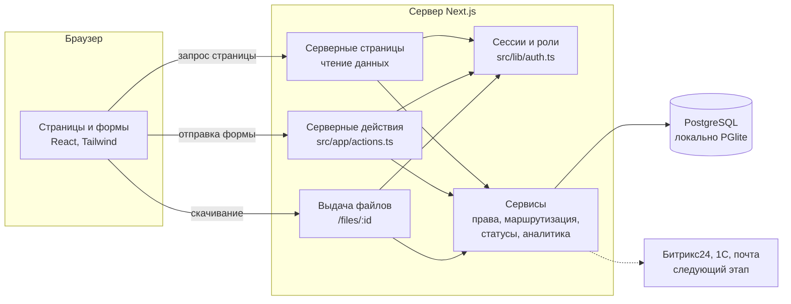
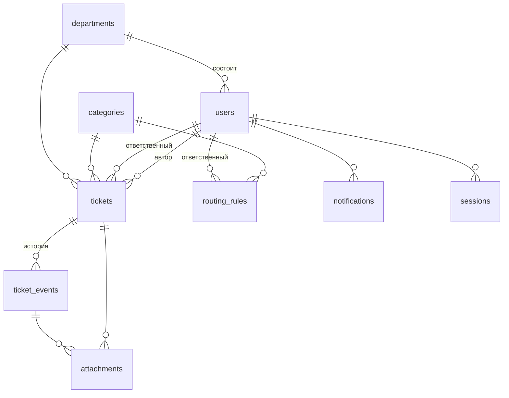
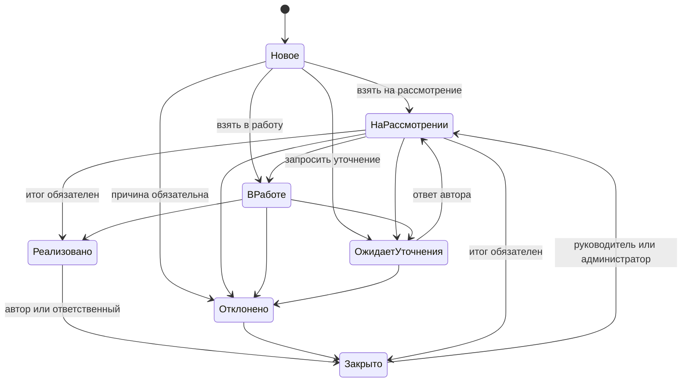

# Архитектура

## Схема



Один процесс, один репозиторий. Отдельного API-сервера нет: страницы читают данные на сервере, формы вызывают серверные действия. Вся логика и все проверки прав находятся в слое сервисов, который не зависит от Next.js и тестируется отдельно.

## Выбор технологий

| Технология | Зачем |
| --- | --- |
| Next.js 15, TypeScript | Интерфейс и сервер в одном проекте, типы от базы до формы, быстрый деплой |
| PostgreSQL | Транзакции для смены статусов и нумерации, агрегаты для аналитики, готовая база для роста |
| PGlite | Тот же диалект PostgreSQL без установки сервера: запуск одной командой, тесты в памяти |
| Tailwind CSS 4 | Дизайн-токены в одном файле, без библиотеки компонентов |
| zod | Серверная валидация ввода |
| lucide-react | Иконки |

Библиотека UI-компонентов не подключалась: формы построены на нативных элементах (`select`, `dialog`, `details`), что даёт клавиатурную доступность и нормальное поведение на телефоне без лишних зависимостей. LLM и ML не используются: маршрутизация и поиск похожих обращений работают по детерминированным правилам.

## Структура проекта

```
src/
  app/
    actions.ts            серверные действия: вход, обращения, администрирование
    login/                вход, демо-аккаунты
    (app)/                разделы после входа: my, queue, overview, tickets, analytics, notifications, admin
    files/[id]/route.ts   выдача вложений
    globals.css           дизайн-токены
  components/             ui.tsx (кнопки, поля, метки), client.tsx (формы, диалог), ticket-list.tsx, nav.tsx
  db/                     index.ts (адаптер PGlite / pg), migrations.ts, seed.ts, dataset.json
  lib/
    domain.ts             типы, статусы, действия, права на обращение
    services/             tickets, routing, analytics, admin, notifications
    auth.ts, password.ts, similarity.ts, format.ts
tests/                    интеграционные тесты сервисов
```

## Модель данных



| Таблица | Назначение |
| --- | --- |
| `tickets` | Обращение: тип, категория, подразделение, автор, ответственный, приоритет, статус, итог, даты |
| `ticket_events` | Неизменяемая история: создание, назначение, статус, комментарий, уточнение, приоритет, срок |
| `attachments` | Файлы (до 5 МБ) в базе, привязаны к обращению и событию |
| `categories` | Категория и срок рассмотрения в днях |
| `routing_rules` | Категория + необязательные тип и подразделение → ответственный |
| `users`, `departments`, `sessions` | Пользователи, роли, отсутствие, сессии |
| `notifications` | Уведомления внутри приложения |
| `settings`, `audit_log` | Параметры и журнал изменений настроек |

Полная схема: `src/db/migrations.ts`.

## Жизненный цикл обращения



После ответа автора обращение возвращается в тот статус, из которого было запрошено уточнение. Переходы описаны в одном месте (`ACTION_DEFS` в `src/lib/domain.ts`) и проверяются сервером в транзакции с блокировкой строки, поэтому повторная отправка из устаревшей вкладки отклоняется.

## Маршрутизация

1. Берутся правила категории, подходящие по типу и подразделению обращения.
2. Правила сортируются по точности: совпадение типа весит 2, подразделения 1.
3. Обращение получает первый доступный ответственный (активен и не отмечен отсутствующим).
4. Если правила нет или все ответственные недоступны, обращение получает резервный ответственный из параметров.
5. Причина назначения записывается в историю обращения.

Администратор может проверить любое сочетание «категория, тип, подразделение» на вкладке «Маршрутизация» без создания обращения.

## Безопасность и доступ

| Мера | Реализация |
| --- | --- |
| Аутентификация | Логин и пароль; хэш scrypt с солью; в cookie случайный токен, в базе его SHA-256 |
| Сессия | Cookie `HttpOnly`, `SameSite=Lax`, `Secure` в продакшене; срок 12 часов; отключение пользователя удаляет его сессии |
| Перебор пароля | 5 неудачных попыток за 5 минут на логин (в памяти процесса) |
| Права | Проверяются в сервисах на каждое действие; роль читается из базы на каждый запрос |
| Доступ к данным | Любая выборка обращений строится через `scopeSql`; чужое обращение неотличимо от несуществующего |
| Внутренние заметки | Не попадают в ответ автору, как и вложения к ним |
| Файлы | Белый список расширений, лимит 5 МБ, проверка сигнатуры содержимого; отдаются только на скачивание с `nosniff` и `Content-Security-Policy: sandbox` |
| SQL | Только параметризованные запросы |
| CSRF | Серверные действия Next.js проверяют источник запроса |
| Заголовки | `X-Frame-Options: DENY`, `X-Content-Type-Options: nosniff`, `Referrer-Policy: same-origin` |
| Секреты | Только в переменных окружения; `.env.local` не попадает в репозиторий |
| Журнал | Изменения категорий, правил, пользователей и параметров пишутся в `audit_log` |

Матрица прав на обращение:

| Действие | Автор | Ответственный | Руководитель подразделения | Администратор |
| --- | --- | --- | --- | --- |
| Просмотр | да | да | да | да |
| Комментарий | да | да | да | да |
| Внутренняя заметка | нет | да | да | да |
| Смена статуса, приоритета, срока | нет | да | да | да |
| Ответ на уточнение, подтверждение закрытия | да | нет | нет | нет |
| Смена ответственного, возврат из закрытых | нет | нет | да | да |

Что нужно добавить до промышленной эксплуатации: вход через корпоративную учётную запись (SSO), политика паролей и их смена, ограничение запросов на уровне прокси, антивирусная проверка вложений, резервное копирование базы, политика хранения данных.

## Интеграции (не реализованы, предложение по ТЗ 3.4)

| Система | Цель | Данные и направление | Что уточнить |
| --- | --- | --- | --- |
| Битрикс24 | Единый вход и актуальная оргструктура | Из Битрикс24: сотрудники, подразделения, руководители. Способ: OAuth и REST | Версия (облако или коробка), доступные права приложения |
| Битрикс24 | Уведомления там, где люди уже работают | В Битрикс24: сообщение автору и ответственному со ссылкой на обращение | Допустим ли чат-бот или нужны уведомления живой ленты |
| Битрикс24 | Реализация принятых предложений | В Битрикс24: задача по обращению в статусе «В работе»; обратно: статус задачи | Кто владелец задач, нужна ли двусторонняя синхронизация |
| 1С УТ | Справочники для категорий, связанных с номенклатурой и документами | Из 1С: только справочные данные, без коммерческих условий | Способ доступа (HTTP-сервисы, OData), какие сведения разрешено выгружать |

Точка расширения: уведомления создаются одной функцией `notify` в `src/lib/services/tickets.ts`; внешние каналы подключаются там же. Пользователи и подразделения изолированы в таблицах `users` и `departments`, синхронизация их заменяет ручной ввод.

## Масштабирование

- Приложение не хранит состояния в памяти, кроме счётчика попыток входа: при нескольких экземплярах он переносится в базу или Redis.
- Вложения сейчас в базе. При росте объёма переносятся в объектное хранилище, в базе остаются метаданные.
- Поиск похожих обращений сравнивает тексты попарно в памяти. До нескольких тысяч обращений этого достаточно, дальше нужен полнотекстовый индекс PostgreSQL (`tsvector`, конфигурация `russian`).
- Списки уже постраничные, индексы по автору, ответственному, подразделению и статусу созданы.
